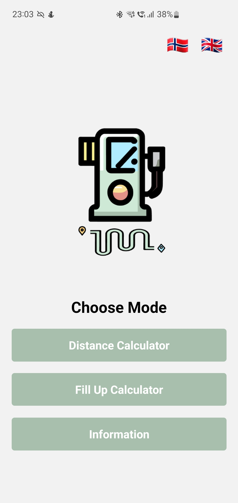
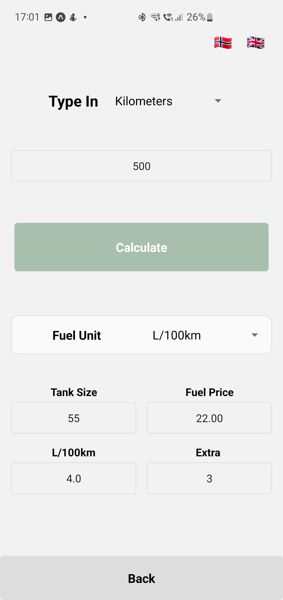
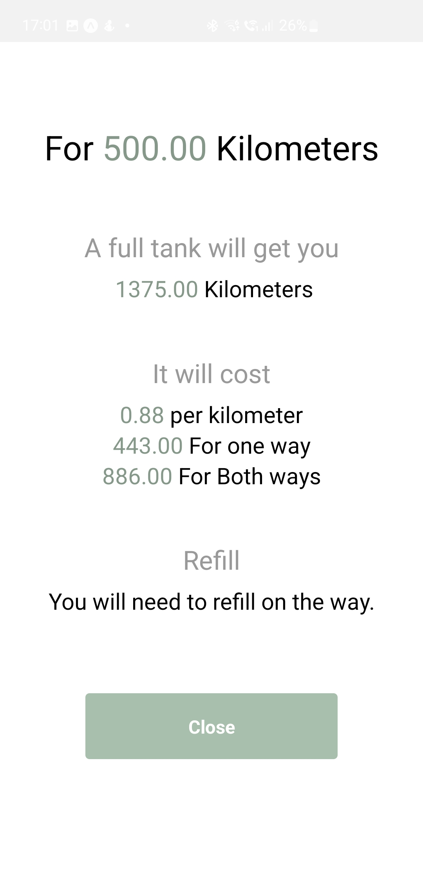
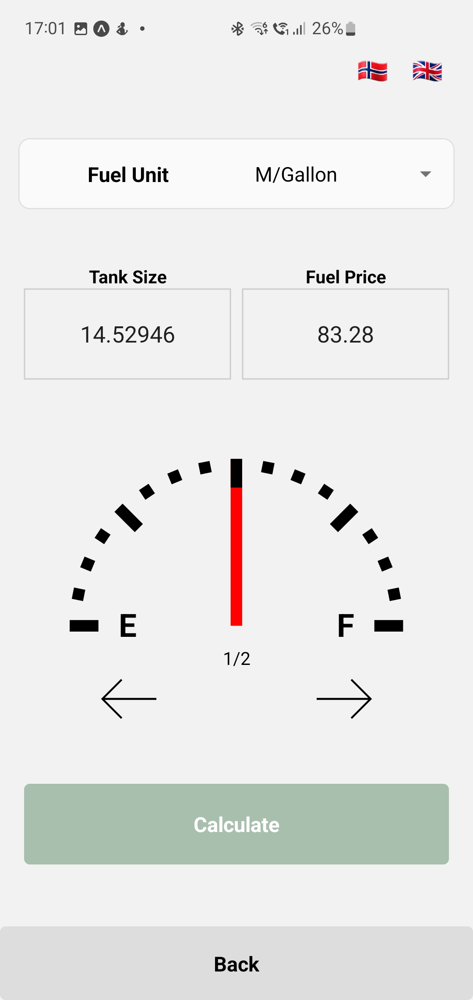
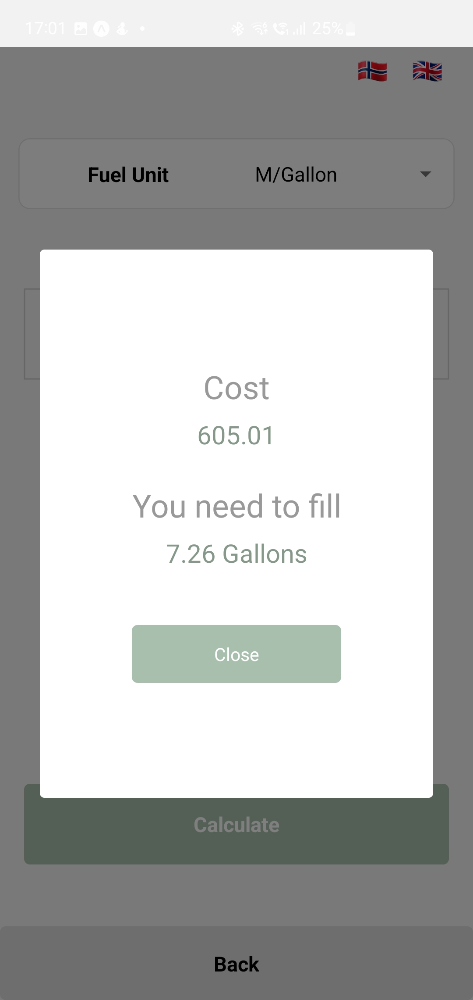
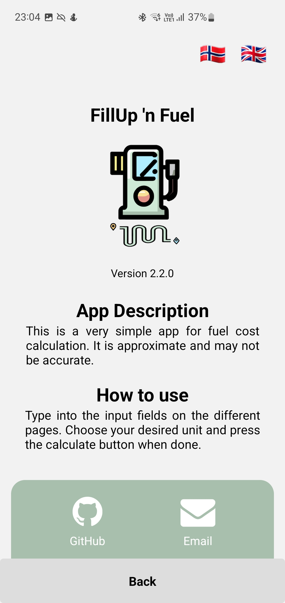

<p align="center">
  
</p>

# FillUp-n-Fuel
A very simple Android app calculating fuel cost for a certain distance and how much it will cost to fill up the tank. [Go to screenshots](#screenshots).

Native Android: Kotlin and Jetpack Compose.

## Build

Needs JDK 17+ and the Android SDK (platform 37.1).

```sh
./gradlew test              # unit tests for the calculations
./gradlew installDebug      # build and install on a connected device or emulator
./gradlew bundleRelease     # Play Store bundle (signed when keystore.properties exists)
```

`keystore.properties` (git-ignored) points release builds at the Play upload key:

```properties
storeFile=upload-keystore.jks
storePassword=…
keyAlias=…
keyPassword=…
```

## Structure

- `core` – plain Kotlin: units, conversions, trip and fill-up calculations. No Android dependency; unit-tested.
- `app` – the Android app: Compose UI, navigation, saved settings (DataStore), translations (`res/values`, `res/values-nb`).

# License
[GNU General Public License v3.0](https://github.com/ThuWorkshop/FillUp-n-Fuel/blob/31c118058fe5653f293d79648785af0ccbbcef97/LICENSE)

# Privacy Policy
[Privacy Policy](https://github.com/ThuWorkshop/FillUp-n-Fuel/blob/31c118058fe5653f293d79648785af0ccbbcef97/privacyPolicy.md)

<a id="screenshots"></a>
# Screenshots
<p align="center">
  
  
  
  
  
  
</p>
