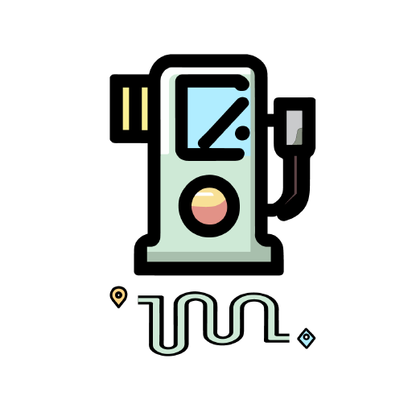
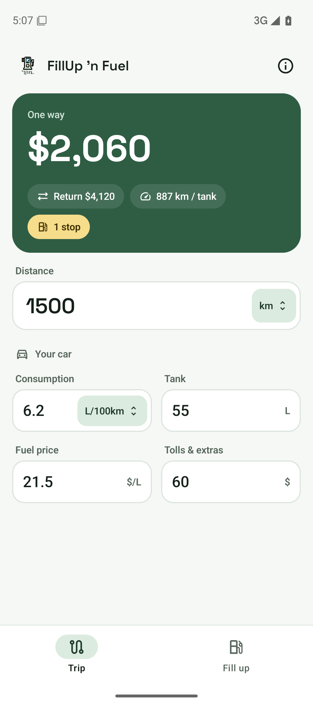
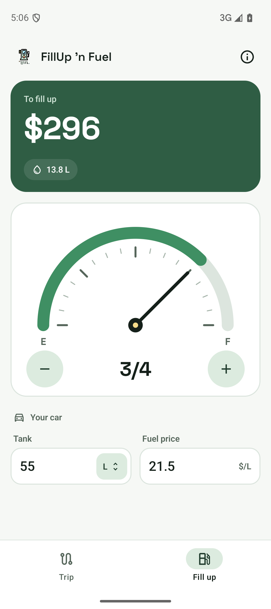
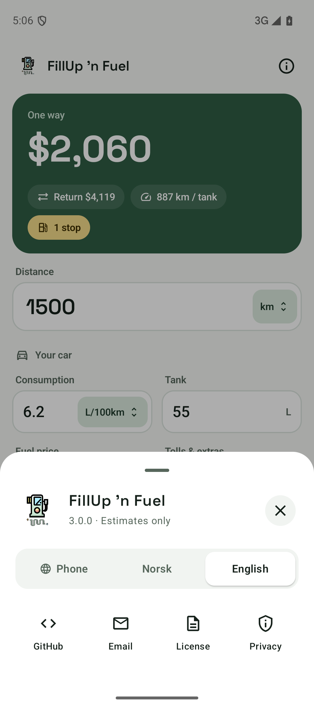

<p align="center">
  
</p>

# FillUp-n-Fuel
A very simple Android app calculating fuel cost for a certain distance and how much it will cost to fill up the tank. [Go to screenshots](#screenshots).

Native Android: Kotlin and Jetpack Compose.

## Build

Needs JDK 17+ and the Android SDK (platform 37.1).

```sh
./gradlew test              # unit tests for the calculations
./gradlew installDebug      # build and install on a connected device or emulator
./gradlew bundleRelease     # Play Store bundle (signed when keystore.properties exists)
```

## Release

Push a tag; GitHub Actions tests, builds, signs and uploads the bundle to Play's **internal testing** track, where you promote it:

```sh
git tag v3.0.1 && git push origin v3.0.1
```

The tag sets the version (`v3.0.1` → versionName 3.0.1, versionCode 30001). Update `release-notes/whatsnew/` (Play's "What's new", max 500 characters per language) before tagging. The workflow needs the secrets `UPLOAD_KEYSTORE_BASE64`, `UPLOAD_KEYSTORE_PASSWORD` and `PLAY_SERVICE_ACCOUNT_JSON`.

For local release builds, `keystore.properties` (git-ignored) points at the Play upload key (backed up in 1Password):

```properties
storeFile=upload-keystore.jks
storePassword=…
keyAlias=…
keyPassword=…
```

## Structure

- `core` – plain Kotlin: units, conversions, trip and fill-up calculations. No Android dependency; unit-tested.
- `app` – the Android app: Compose UI (Trip and Fill up tabs, info sheet), saved settings (DataStore), translations (`res/values`, `res/values-nb`).

Headings and numbers use [Space Grotesk](https://github.com/floriankarsten/space-grotesk) (SIL Open Font License, copy in `app/src/main/assets/licenses/`).

# License
[GNU General Public License v3.0](https://github.com/ThuWorkshop/FillUp-n-Fuel/blob/31c118058fe5653f293d79648785af0ccbbcef97/LICENSE)

# Privacy Policy
[Privacy Policy](https://github.com/ThuWorkshop/FillUp-n-Fuel/blob/31c118058fe5653f293d79648785af0ccbbcef97/privacyPolicy.md)

<a id="screenshots"></a>
# Screenshots
<p align="center">
  
  
  
</p>
